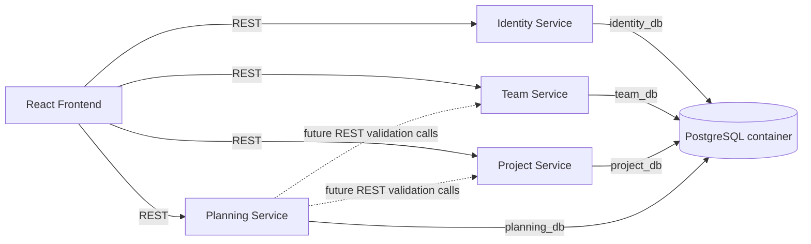

# TeamFlow — Initial Architecture

**Status:** Approved initial direction; incremental implementation in progress
**Scope:** MVP foundation
**Date:** 2026-11-23

## 1. Architectural decisions

- The backend starts as four independent Spring Boot services.
- The services communicate synchronously through REST initially.
- No messaging infrastructure is introduced in the MVP foundation.
- Each service has a separate PostgreSQL database and owns its migrations and data.
- The frontend is an independent React application using JavaScript and CSS.
- Docker Compose runs the local environment.
- Micro Frontends are not implemented in this stage.
- Team and Project services now contain their initial CRUD functionality; Planning workflows remain unimplemented.

## 2. Service responsibilities

| Service | Responsibility | Own database |
|---|---|---|
| Identity Service | Users, authentication and organizations. | `identity_db` |
| Team Service | Teams, aggregated composition, competencies and registered availability. Ownership of employee records and team memberships remains pending. | `team_db` |
| Project Service | Projects, services and locations. | `project_db` |
| Planning Service | Project-oriented planning, allocations, transportation and conflicts involving teams and employees. | `planning_db` |

The service boundaries remain limited to the approved responsibilities. Team and Project domains have initial CRUD entities and workflows; allocation, transportation and conflict workflows remain assigned to the Planning Service and are not implemented yet.

## 3. Data ownership

Each service owns its database and migration responsibility. Services must not read or write another service's tables directly.

Cross-service data access will use REST contracts and only the information necessary for the requested operation. Shared database tables, cross-service SQL joins and direct mutation of another service's data are not part of the approved foundation.

`organization_id` is considered from the beginning in the service configuration and future domain design, but the detailed multi-organization rules remain pending in the product documentation.

## 4. Communication

The initial communication style is synchronous REST:

- the frontend calls the service that owns the requested operation;
- Planning Service will later consult Team Service and Project Service for planning validations;
- Identity Service will later support authentication and organization context;
- contracts and authorization between services must be documented before business workflows are implemented.

Asynchronous communication may be evaluated later for derived views, notifications, or long-running work. It is deliberately not included in the MVP foundation.

## 5. Local execution

Docker Compose provides:

- one PostgreSQL container;
- four logical databases created by the PostgreSQL initialization script;
- one container for each backend service;
- one frontend container running the JavaScript development server;
- service-specific environment variables and ports;
- health checks for PostgreSQL and the application containers.

The single PostgreSQL container is a local infrastructure choice. Logical database ownership remains separated by service. A production topology has not been decided.

## 6. Initial dependency direction

The dashed calls are future business integrations. They are not implemented in the current incremental stage.

## 7. Pending decisions

- Exact domain contracts between Planning, Team and Project services, including employee and membership data.
- Ownership of employee records, team memberships and individual availability.
- Authentication and authorization flows between services.
- Organization isolation and the final `organization_id` model.
- Migration tooling and migration execution policy per service.
- Conflict and availability rules that remain pending in `BUSINESS_RULES.md`.
- Production deployment and PostgreSQL topology.
- Whether a separate read/reporting service is needed.
- Whether Micro Frontends provide enough benefit to justify their complexity.

## 8. Núcleo operacional implementado

O Team Service mantém `employees`, `team_memberships` e `employee_unavailability` em seu próprio banco. O Project Service mantém os dados auxiliares existentes e recebeu os campos aditivos `priority`, `continuous_execution` e `desired_people`; a lista legada de localidades não é apagada nesta transição. O Planning Service mantém `allocations`, `transports` e `planning_proposals` em `planning_db`.

Os contratos usam REST síncrono e `X-Organization-Id` em todas as operações de negócio. A primeira versão do Planning Service usa JDBC, Flyway e transações locais; referências de projetos, equipes e funcionários são UUIDs sem chaves estrangeiras entre bancos. Falhas de comunicação externa devem ser tratadas como indisponibilidade técnica antes de confirmar propostas; a validação remota completa e timeouts configuráveis são próximos passos.

### Estratégia heurística

A proposta inicial é um esqueleto determinístico de prioridade-prazo: projetos são ordenados por prioridade descendente, prazo ascendente e identificador como desempate; recursos e períodos viáveis são avaliados sem modificar compromissos fixados. Conflitos bloqueantes são restrições obrigatórias. A complexidade esperada da versão completa é O(P × R × D + A), onde P é o número de projetos, R de recursos, D de dias candidatos e A de compromissos existentes. A abordagem não garante ótimo matemático; deve ser avaliada por atendimento de prazo, prioridade, antecipação, ociosidade, deslocamentos e projetos não atendidos.

### Pendências técnicas

Ainda faltam clientes REST efetivamente usados pelo Planning Service para Team/Project com timeout, controle otimista de versão de propostas, endpoints completos de edição de alocações e transportes, e testes de integração do fluxo vertical. Essas lacunas estão registradas como trabalho restante.
